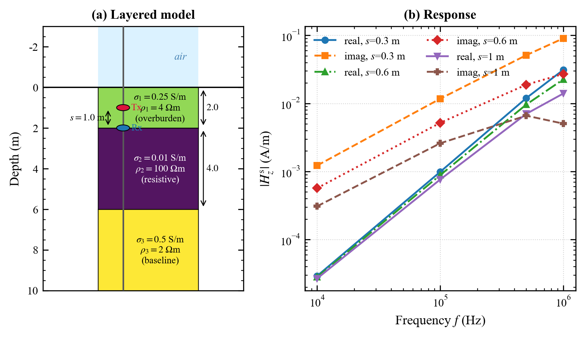
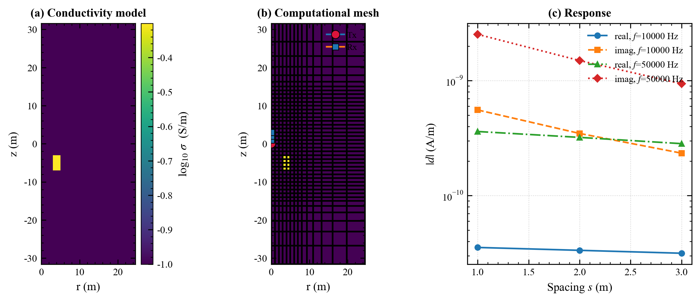
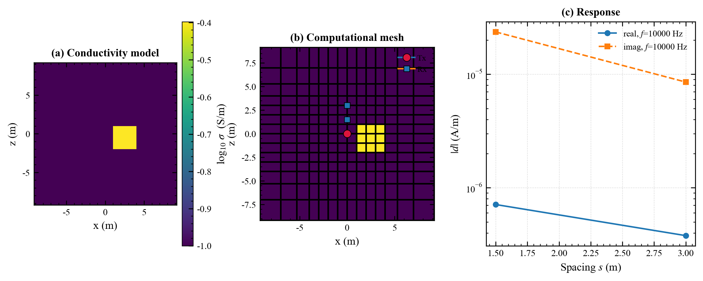
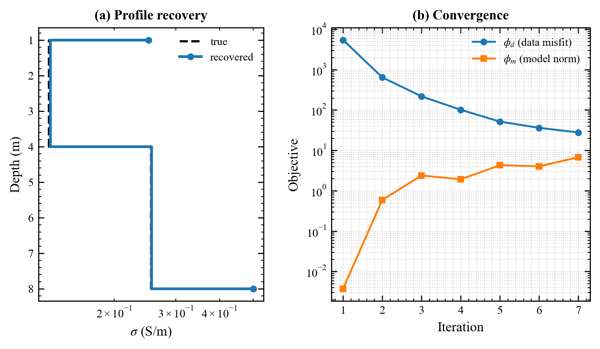
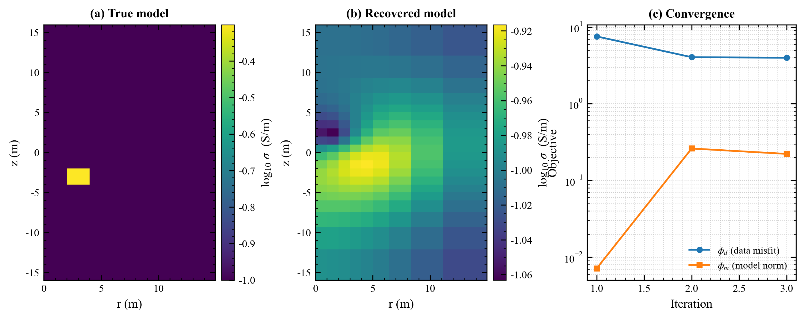

# LWD-EM-Inv

随钻电磁波测井（LWD-EM）数据的正演模拟与反演代码库。

## 概述

LWD-EM-Inv 提供频域电磁（FDEM）随钻测井的正反演工具。计算核心 `src/fdemcore`
由 SimPEG 精简派生，实现 1D 层状（Hankel 解析）、2D 轴对称与 3D 直角的有限体积
正演；业务层 `src/lwd_fdem` 在其上封装仪器配置、网格生成、反演管线、数据读写与
可视化。`fdemcore` 不依赖 pip 安装的 SimPEG。

主要能力：

- 频域电磁正演：1D 层状、2D 轴对称、3D 直角三种几何
- Occam 风格反演：对数电导率参数化、加权最小二乘平滑、β 冷却、拟合差停止
- 观测系统：多频率、多收发距、实部/虚部，磁偶极子源与线圈源
- 合成数据与不确定度处理、模型与响应可视化

## 环境

Python 3.10 及以上（开发验证于 3.13）。`fdemcore` 与 `lwd_fdem` 依赖
`discretize`、`pymatsolver`、`geoana`、`libdlf`，版本约束见 `requirements.txt`。

## 安装

```bash
conda create -n lwd-eminv python=3.13
conda activate lwd-eminv
pip install -r requirements.txt

git clone https://github.com/swpucwf/LWD-EM-Inv.git
cd LWD-EM-Inv
python setup.py install
```

## 快速开始

正演（1D 层状，多频多收发距）：

```python
import numpy as np
from src.lwd_fdem import LWDFDEMForward, LWDToolConfig

tool = LWDToolConfig(
    frequencies=(1e4, 1e5, 5e5, 1e6),
    spacings=np.array([0.3, 0.6, 1.0]),
    components=("real", "imag"),
    field_kind="h", secondary=True, receiver_geometry="radial",
)
fwd = LWDFDEMForward("1d", tool, layer_thicknesses=np.array([2.0, 4.0]))
d = fwd.dpred(np.array([0.25, 0.01, 0.5]))
print(fwd.to_matrix(d).shape)   # (n_freq, n_spacing, n_comp)
```

反演（合成数据回收）：

```python
from src.lwd_fdem import add_synthetic_noise, make_data_object, LWDFDEMInversion

dobs, std = add_synthetic_noise(d, noise_level=0.02, seed=1)
data = make_data_object(fwd.survey, dobs, absolute_std=std)
inv = LWDFDEMInversion(fwd, data, m0=np.log(0.1 * np.ones(3)), max_iter=15)
sigma_recovered, history = inv.run()
```

2D 轴对称与 3D 几何通过 `LWDFDEMForward("2d_cyl", tool, mesh=...)` 与
`LWDFDEMForward("3d", tool, mesh=...)` 使用，网格由 `build_2d_cyl_mesh`、
`build_3d_tensor_mesh` 生成。完整脚本见 `examples/`。

## 运行示例与测试

```bash
python examples/lwd_fdem_forward_1d.py
python examples/lwd_fdem_inversion_1d.py

pytest -m "not slow"    # 快速回归
pytest                  # 含 3D 反演等耗时用例
```

## 示例

以下图版由 `examples/` 中的脚本生成。

图 1：1D 层状正演。(a) 三层地电模型与井轴上的收发线圈；(b) 二次场幅度随频率变化。



图 2：2D 轴对称正演（r-z）。(a) 电导率模型；(b) 计算网格；(c) 响应随收发距变化。



图 3：3D 直角正演（y=0 切片），井旁方块导体。



图 4：Occam 反演。左：1D 剖面回收与收敛史；右：2D 真实模型、回收模型与收敛史。





绘图接口位于 `src/lwd_fdem/plotting.py`：

```python
from src.lwd_fdem import plot_forward_figure, plot_inversion_figure, pub_style

plot_forward_figure(fwd, sigma, d, out_dir="examples/figs",
                    prefix="lwd_fdem_forward_2d")
plot_inversion_figure(fwd, rec_sigma, history, sigma_true=sigma_true,
                      out_dir="examples/figs", prefix="lwd_fdem_inversion_1d")
```

## 井型正反演示例

除基础示例外，`examples/` 提供成对的水平井 / 垂直井案例（均中英双语、图版按案例分目录）：

| 示例脚本 | 井型/几何 | 演示内容 |
|---|---|---|
| `horizontal_well_3layer.py` | 水平井 · 1D 层状 · 径向偏移 | 建模→网格→观测→正演→合成数据→Occam 反演→收敛（图 01–07） |
| `vertical_well_3layer.py` | 垂直井 · 2D 轴对称 · 轴向偏移 | 磁偶极子点接收、沿深度连续穿透扫描、实部/虚部/幅值/相位（图 01–05） |
| `horizontal_well_advanced.py` | 水平井 · 1D | 二次场 vs 总场；Occam 平滑 vs 稀疏反演 |
| `vertical_well_advanced.py` | 垂直井 · 2D | 磁偶极子 vs 回线源 CircularLoop；Occam vs 稀疏反演 |

> 进阶示例演示了此前“底层具备、示例未接入”的能力，并在**不改底层代码**前提下用业务层
> 子类封装规避了两处 `LWDFDEMInversion(sparse=True)` 限制：① `BetaSchedule` 与 `UpdateIRLS`
> 冲突（子类过滤掉 BetaSchedule）；② 稀疏 `norms` 长度须 = 1+网格维数（2D 传 `[0,1,1]`）。
> 这两处业务层封装本身的修正列为待做 TODO。

## 目录结构

```
LWD-EM-Inv/
├── src/
│   ├── fdemcore/          频域电磁 FVM 计算核心（SimPEG 精简派生，MIT）
│   └── lwd_fdem/          LWD 正反演业务层（survey/meshes/forward/inversion/plotting）
├── examples/              正反演示例脚本
├── tests/                 测试（解析对标、交叉验证、梯度校验、反演回收）
├── docs/                  架构说明、编码规范、项目知识库
├── external/SimPEG-src/   SimPEG 上游源码存档（不参与打包，不入库）
├── CONTRIBUTING.md
├── THIRD_PARTY_LICENSES.md
├── requirements.txt
└── setup.py
```

## 建模选项与待完善功能（Roadmap / TODO）

> 已对照代码核实（fdemcore 派生自 SimPEG，多数源/接收/正则化能力底层已具备）。
> 标记：`[x]` 已实现可用 · `[~]` 底层已具备、示例/业务层未封装 · `[ ]` 待实现。

### 源（发射）

- [x] 竖直磁偶极子 `MagDipole`（点偶极）——水平井/垂直井示例已用
- [x] 有限尺寸圆形回线源 `CircularLoop`（`source_type="circular_loop"` 已接入；注：1D 层状仅支持零偏移中心回线，带偏移的源型对比见 2D 示例 `vertical_well_advanced.py`）
- [x] 任意/倾斜取向磁偶极子（`MagDipole(orientation=...)` 支持非轴向量）
- [x] 接地线电流源 `LineCurrent`、任意矢量源 `RawVec/RawVec_e/RawVec_m`
- [~] 多分量源阵列（三轴/方位天线）——可多源组合，业务层未封装

### 接收器

- [x] 点接收（`PointMagneticField/FluxDensity`，实部/虚部）——当前默认
- [~] 多分量/张量接收（Hx/Hy/Hz）——用不同 `orientation` 的点接收器组合可得，未封装
- [ ] 有限尺寸线圈接收（有效面积 N·A、沿线圈长空间平均）——fdemcore 无回线接收器类
- [ ] 方位敏感接收（各向异性/边界 azimuth 响应）

### 井眼几何与仪器姿态

- [x] 垂直井（2D 轴对称，轴向偏移）；水平井（1D 层状，径向偏移近似）
- [~] 水平井完整 3D、倾斜/定向井、仪器偏心、真实轨迹——`Simulation3D*` 具备能力，示例未建

### 地层模型

- [x] 各向同性水平层状（1D）/ 轴对称 r-z（2D）/ 直角（3D）
- [x] 非均匀磁导率（`muMap`）
- [~] 侵入剖面、倾斜地层/断层——2D/3D 模型可表达，示例未演示
- [ ] 电导率各向异性 VTI/HTI（FDEM 仿真未接各向异性 σ）
- [ ] 介电色散/频变（Cole-Cole；现仅常数 `permittivity`）

### 物理近似

- [x] 全频域 Maxwell（保留位移电流），`exp(+iωt)`；准静态可由 `permittivity=None` 退化
- [ ] 源-接收互易性建模与加速

### 反演

- [x] Occam 风格：log-σ 参数化、WLS 平滑、β 冷却、目标拟合差停止
- [x] 稀疏/块状正则化（`regularization.Sparse`；注：`LWDFDEMInversion(sparse=True)` 有业务层封装 bug——BetaSchedule/UpdateIRLS 冲突、norms 长度需=1+dim；示例经子类规避（`*_advanced.py`），封装本身待修）
- [x] 参数化模型反演（`ParametricLayer/ParametricCasingAndLayer/ParametricBlock` 等 maps）
- [~] 交叉梯度/结构耦合/PGI 联合反演（`CrossGradient/PGI/JTV` 底层具备，业务层未封装联合管线）
- [ ] 各向异性参数反演（依赖上面的各向异性正演）
- [ ] 不确定度/分辨率分析（贝叶斯 / 灵敏度 / DOI）
- [ ] 快速反演（降阶模型 / 插值字典 / 实时成像）

### 数据处理

- [x] 合成高斯噪声 + 绝对/相对标准差
- [x] CSV 实测数据加载（`load_lwd_csv`）
- [ ] 环境校正（井眼、温度、泥浆）
- [ ] 仪器标定（tool factor、幅度/相位标定到视电导率）
- [ ] LAS / 厂商深度块等更多实测格式

### 数值与网格

- [x] TensorMesh / CylindricalMesh + FVM + SuperLU/BiCGStab
- [x] 可选高效求解器（`LWDFDEMForward(solver=...)`，pymatsolver 支持 Pardiso/MUMPS）
- [~] 自适应 / TreeMesh（discretize 具备，fdemcore 仿真未针对其验证）
- [ ] 非结构化 / 四面体网格（复杂井轨迹）

> 真缺项（`[ ]`）重点：线圈接收器——点接收在 ℓ≪δ 下成立，效应①（N·A·ω）为标量/单位/相位、
> 效应②（有限尺寸空间平均）为二阶小量；推荐实现为业务层「线圈→多点线性组合」，不改 fdemcore。
> 以及 FDEM 电导率各向异性、Cole-Cole 频散、不确定度/ROM、环境校正与标定。

## 引用

反演算法参考 Occam 反演（Constable et al., 1987, *Geophysics*）与反演问题理论
（Tarantola, 2005, *SIAM*）。计算核心派生自 SimPEG。

## 许可证

本项目以 Apache-2.0 许可发布，详见 [LICENSE](LICENSE)。`src/fdemcore` 派生自
SimPEG（MIT 许可），第三方许可声明见 [THIRD_PARTY_LICENSES.md](THIRD_PARTY_LICENSES.md)。

## 联系

作者：swpucwf — swpucwf@126.com — https://github.com/swpucwf
