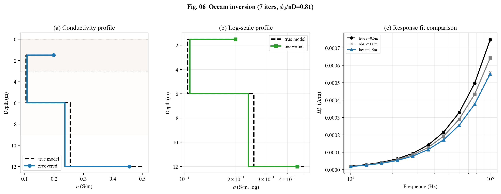
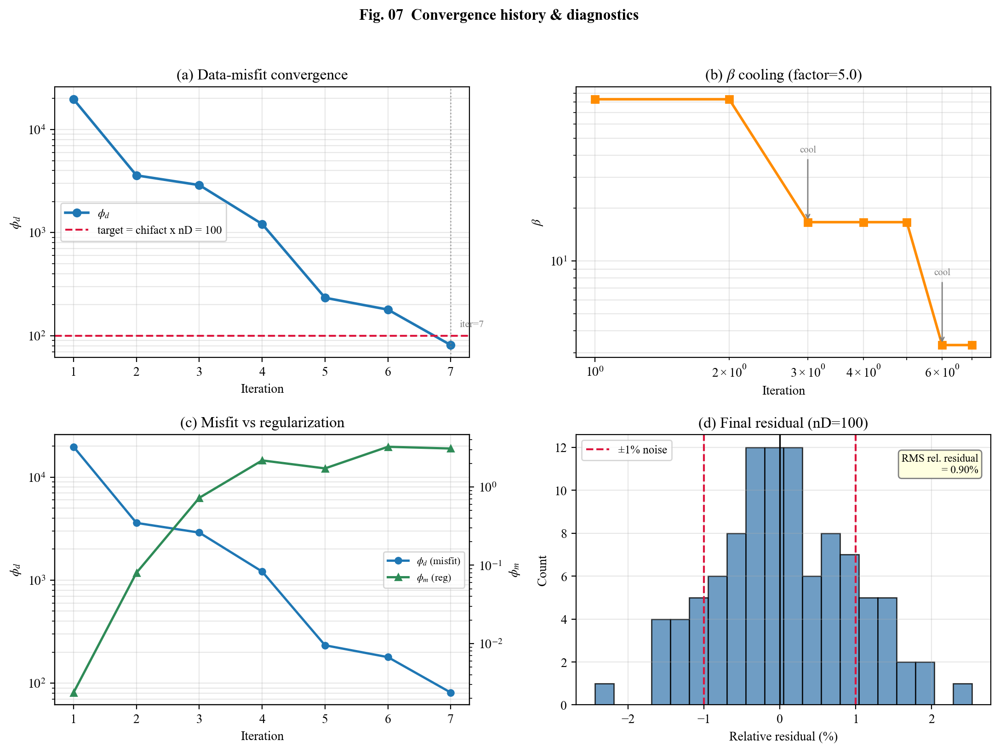
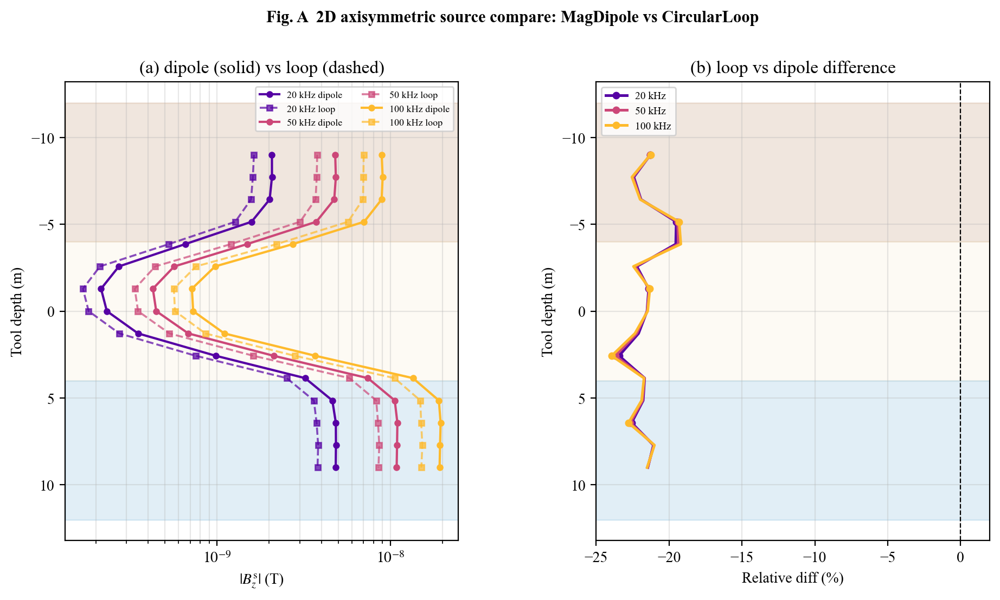
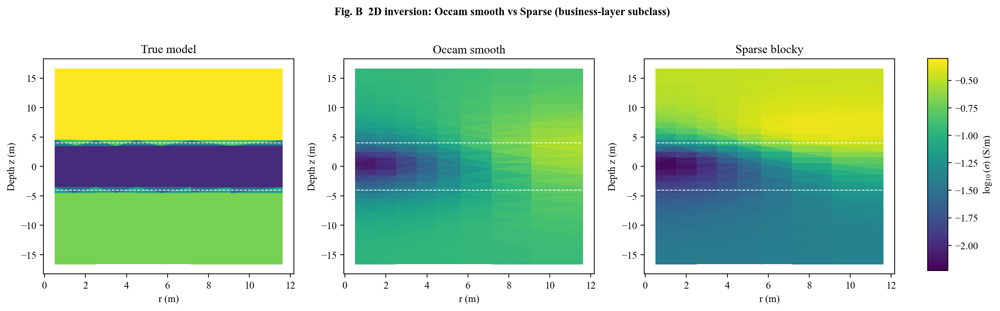
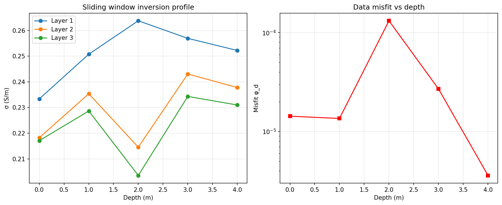

# LWD-EM-Inv

随钻电磁波测井（LWD-EM）数据的正演模拟与反演代码库。

## 概述

LWD-EM-Inv 提供频域电磁（FDEM）随钻测井的正反演工具。计算核心 `src/fdemcore`
由 SimPEG 精简派生，实现 1D 层状（Hankel 解析）、2D 轴对称与 3D 直角的有限体积
正演；业务层 `src/lwd_fdem` 在其上封装仪器配置、网格生成、反演管线、数据读写与
可视化。`fdemcore` 不依赖 pip 安装的 SimPEG。

主要能力：

- 频域电磁正演：1D 层状、1D 张量、2D 轴对称、2D 张量、3D 直角五种几何路径
- 电导率各向异性 VTI 正演（1d_tensor / 2d_tensor / 3D）
- Cole-Cole 频散正演（仅 1D，Pelton 公式）
- 张量观测系统：三轴源 × 三轴接收（9 分量）
- Occam 风格反演 + 稀疏/块状正则化（IRLS）
- 视电阻率转换、灵敏度分析、滑动窗口反演、探测深度（DOI）估计
- 合成数据与不确定度处理、LAS 2.0 导出、模型与响应可视化
- 论文正演复现与交叉验证套件（`paper/`）

## 环境

Python 3.10 及以上（开发验证于 3.13）。`fdemcore` 与 `lwd_fdem` 依赖
`discretize`、`pymatsolver`、`geoana`、`libdlf`，版本约束见 `requirements.txt`。

## 安装

```bash
conda create -n lwd-eminv python=3.13
conda activate lwd-eminv
pip install -r requirements.txt

git clone https://github.com/swpucwf/LWD-EM-Inv.git
cd LWD-EM-Inv
python setup.py install
```

## 快速开始

正演（1D 层状，多频多收发距）：

```python
import numpy as np
from src.lwd_fdem import LWDFDEMForward, LWDToolConfig

tool = LWDToolConfig(
    frequencies=(1e4, 1e5, 5e5, 1e6),
    spacings=np.array([0.3, 0.6, 1.0]),
    components=("real", "imag"),
    field_kind="h", secondary=True, receiver_geometry="radial",
)
fwd = LWDFDEMForward("1d", tool, layer_thicknesses=np.array([2.0, 4.0]))
d = fwd.dpred(np.array([0.25, 0.01, 0.5]))
print(fwd.to_matrix(d).shape)   # (n_freq, n_spacing, n_comp)
```

反演（合成数据回收）：

```python
from src.lwd_fdem import add_synthetic_noise, make_data_object, LWDFDEMInversion

dobs, std = add_synthetic_noise(d, noise_level=0.02, seed=1)
data = make_data_object(fwd.survey, dobs, absolute_std=std)
inv = LWDFDEMInversion(fwd, data, m0=np.log(0.1 * np.ones(3)), max_iter=15)
sigma_recovered, history = inv.run()
```

2D 轴对称与 3D 几何通过 `LWDFDEMForward("2d_cyl", tool, mesh=...)` 与
`LWDFDEMForward("3d", tool, mesh=...)` 使用，网格由 `build_2d_cyl_mesh`、
`build_3d_tensor_mesh` 生成。完整脚本见 `examples/`。

## 运行示例与测试

```bash
python examples/lwd_fdem_forward_1d.py
python examples/lwd_fdem_inversion_1d.py

pytest -m "not slow"    # 快速回归
pytest                  # 含 3D 反演等耗时用例
```

## 示例图版

以下图版由 `examples/` 中的脚本运行生成。

### 基础正演与反演

图 1：1D 层状正演。(a) 三层地电模型示意（含 Tx/Rx 线圈位置、层厚与电导率标注）；(b) 二次场幅度 |H_z^s| 随频率变化，3 个收发距、实部/虚部分开绘制。


图 2：2D 轴对称正演（r-z 剖面）。(a) 电导率模型（环状异常体）；(b) 计算网格（含 Tx/Rx 标注）；(c) 响应幅度随收发距变化，2 个频率。


图 3：3D 直角正演（y=0 切片），井旁方块导体。(a) 电导率模型；(b) 计算网格（含 Tx/Rx 标注）；(c) 响应幅度随收发距变化。


图 4：Occam 反演。(a) 1D 剖面回收：真实模型与反演结果对比；(b) 收敛史：数据拟合差 φ_d 与模型范数 φ_m 随迭代变化。


图 5：2D 反演。(a) 真实模型（log10 σ，环状异常体）；(b) 回收模型；(c) 收敛史。


图 6：3D 反演冒烟测试。(a) 真实模型（y=0 切片，中心方块异常体）；(b) 反演回收结果。


图 7：解析解对标。(a) 均匀半空间 |H_z| 幅度对比（解析 vs 数值，σ=0.01 S/m，r=100 m）；(b) 相对误差（Re/Im 均 < 1e-6）。


### 井型正反演示例

`examples/` 提供成对的水平井 / 垂直井案例（均中英双语、图版按案例分目录）：

| 示例脚本 | 井型/几何 | 演示内容 |
|---|---|---|
| `horizontal_well_3layer.py` | 水平井 · 1D 层状 · 径向偏移 | 建模→网格→观测→正演→合成数据→Occam 反演→收敛（图 01–07） |
| `vertical_well_3layer.py` | 垂直井 · 2D 轴对称 · 轴向偏移 | 磁偶极子点接收、沿深度连续穿透扫描、实部/虚部/幅值/相位（图 01–05） |
| `horizontal_well_advanced.py` | 水平井 · 1D | 二次场 vs 总场；Occam 平滑 vs 稀疏反演 |
| `vertical_well_advanced.py` | 垂直井 · 2D | 磁偶极子 vs 回线源 CircularLoop；Occam vs 稀疏反演 |

#### 垂直井三层地层（`vertical_well_3layer.py`）

图 8：概念模型。三层地电模型：覆盖层 σ=0.20 S/m、储层 σ=0.01 S/m、基底 σ=0.50 S/m；Tx/Rx 阵列沿井轴连续扫描（offset L=1 m）。


图 9：深度扫描正演响应。(a) 同相分量 Re(B_z^s)；(b) 正交分量 Im(B_z^s)；(c) 幅值 |B_z^s|；(d) 相位。3 个频率（20/50/100 kHz），磁偶极子源、点接收。


图 10：视电导率曲线。由 |H_z^s| 转换的定性视电导率随工具深度变化，3 个频率。


#### 水平井三层地层（`horizontal_well_3layer.py`）

图 11：Occam 反演回收。(a) 电导率剖面回收（线性尺度）；(b) 对数尺度剖面；(c) 响应拟合对比（真实/观测/反演模型）。



图 12：反演收敛诊断。(a) 数据拟合差 φ_d 收敛；(b) β 冷却曲线（factor=5.0）；(c) φ_d vs φ_m；(d) 末次残差分布（RMS rel. residual = 0.90%）。



#### 水平井进阶（`horizontal_well_advanced.py`）

图 13：二次场 vs 总场对比。(a) s=1.5 m 处 |H_z^s| 随频率变化；(b) 总场与二次场相对差异。


图 14：Occam 平滑 vs 稀疏反演。(a) 回收剖面：真实模型、Occam 平滑、Sparse 块状；(b) 数据拟合差 φ_d 收敛对比。


#### 垂直井进阶（`vertical_well_advanced.py`）

图 15：源类型对比。(a) 2D 轴对称 MagDipole（实线）vs CircularLoop（虚线）|B_z^s| 随工具深度变化，3 个频率；(b) 回线与偶极子相对差异。



图 16：2D 反演。(a) 真实模型（log10 σ）；(b) Occam 平滑回收；(c) Sparse 块状回收。



### 高级分析功能

图 17：张量观测系统布局（`test_tensor_survey.py`）。6 个源（x/y/z 取向各 2 个位置）× 12 个三轴接收器的平面布局。


图 18：视电阻率转换（`test_apparent_resistivity.py`）。(a) H_z 幅值（log10）随频率-收发距矩阵；(b) 视电导率（log10），真实 σ=0.1 S/m。


图 19：DOI 探测深度分析（`test_doi_analysis.py`）。(a) 各层灵敏度；(b) 分辨率矩阵 R；(c) 累积深度 DOI（阈值 10%，DOI=2.0 m）。


图 20：灵敏度矩阵（`test_advanced.py`）。(a) J 矩阵（8×3）热图；(b) J^T J 对角元（memory-friendly 模式）。


图 21：滑动窗口反演剖面（`test_sliding_window.py`）。(a) 三层电导率随窗口深度变化；(b) 数据拟合差 φ_d 随深度变化。



图 22：Cole-Cole 频散效应（`cole_cole_dispersion.py`）。(a) |Re(H_s)| 幅值随收发距变化（η=0.3 vs 无频散）；(b) 实部对比，3 个频率（1/10/100 kHz）。


绘图接口位于 `src/lwd_fdem/plotting.py`：

```python
from src.lwd_fdem import plot_forward_figure, plot_inversion_figure, pub_style

plot_forward_figure(fwd, sigma, d, out_dir="examples/figs",
                    prefix="lwd_fdem_forward_2d")
plot_inversion_figure(fwd, rec_sigma, history, sigma_true=sigma_true,
                      out_dir="examples/figs", prefix="lwd_fdem_inversion_1d")
```

## 文档

| 文档 | 说明 |
|------|------|
| [使用手册](docs/USER_GUIDE.md) | 从安装到出图的完整工作流，含代码示例 |
| [参数速查表](docs/PARAMETER_REFERENCE.md) | 所有 API 参数的物理含义、取值范围、典型值 |
| [常见问题](docs/FAQ.md) | 安装报错、正演/反演问题排查与解决方案 |
| [架构说明](docs/ARCHITECTURE.md) | 代码分层与模块职责（面向开发者） |
| [编码规范](docs/CODING_STANDARDS.md) | 命名、注释、测试规范（面向开发者） |

## 目录结构

```
LWD-EM-Inv/
├── src/
│   ├── fdemcore/          频域电磁 FVM 计算核心（SimPEG 精简派生，MIT）
│   └── lwd_fdem/          LWD 正反演业务层（survey/meshes/forward/inversion/plotting）
├── examples/              正反演示例脚本
├── tests/                 测试（解析对标、交叉验证、梯度校验、反演回收）
├── paper/                 论文正演复现与对比（lwd_fdem vs SimPEG）
├── docs/                  架构说明、编码规范、项目知识库
├── external/SimPEG-src/   SimPEG 上游源码存档（不参与打包，不入库）
├── CONTRIBUTING.md
├── THIRD_PARTY_LICENSES.md
├── requirements.txt
└── setup.py
```

## 建模选项与待完善功能（Roadmap / TODO）

标记：`[x]` 已实现 · `[~]` 底层具备、业务层未封装 · `[ ]` 待实现。

### 优先级总览（未完成项）

**P0 高**
- ~~修复 `LWDFDEMInversion(sparse=True)` 业务层封装 bug~~——已修（5868c84）
- 电导率各向异性反演（VTI 正演已具备，缺反演业务层封装）
- 联合反演封装（CrossGradient / PGI / JTV 底层已具备，缺业务层组装）

**P1 中（接实测 / 论文复现所需）**
- 有限尺寸线圈接收器（业务层"线圈→多点线性组合"，不改 fdemcore）
- 水平井完整 3D / 倾斜定向井 / 仪器偏心 / 真实井眼轨迹
- 不确定度与分辨率分析（贝叶斯 / 后验协方差）
- 环境校正（井眼/温度/泥浆）与仪器标定（tool factor）

**P2 低（增强 / 性能）**
- 源-接收互易性加速；快速反演（ROM/插值字典/实时）
- 方位敏感接收；多分量源阵列；自适应/TreeMesh、非结构化四面体网格

### 源（发射）

- [x] 竖直磁偶极子 `MagDipole`（点偶极）——水平井/垂直井示例已用
- [x] 有限尺寸圆形回线源 `CircularLoop`（`source_type="circular_loop"` 已接入；注：1D 层状仅支持零偏移中心回线，带偏移的源型对比见 2D 示例 `vertical_well_advanced.py`）
- [x] 任意/倾斜取向磁偶极子（`MagDipole(orientation=...)` 支持非轴向量）
- [x] 接地线电流源 `LineCurrent`、任意矢量源 `RawVec/RawVec_e/RawVec_m`
- [~] 多分量源阵列（三轴/方位天线）——可多源组合，业务层未封装

### 接收器

- [x] 点接收（`PointMagneticField/FluxDensity`，实部/虚部）——当前默认
- [x] 多分量/张量接收（Hx/Hy/Hz）——`tensor.build_tensor_survey` 三轴源 × 三轴接收
- [ ] 有限尺寸线圈接收（有效面积 N·A、沿线圈长空间平均）——fdemcore 无回线接收器类
- [ ] 方位敏感接收（各向异性/边界 azimuth 响应）

### 井眼几何与仪器姿态

- [x] 垂直井（2D 轴对称，轴向偏移）；水平井（1D 层状，径向偏移近似）
- [~] 水平井完整 3D、倾斜/定向井、仪器偏心、真实轨迹——`Simulation3D*` 具备能力，示例未建

### 地层模型

- [x] 各向同性水平层状（1D）/ 轴对称 r-z（2D）/ 直角（3D）
- [x] 非均匀磁导率（`muMap`）
- [~] 侵入剖面、倾斜地层/断层——2D/3D 模型可表达，示例未演示
- [x] 电导率各向异性 VTI——3D TensorMesh (e-form) 支持张量 σ（`_AnisotropicSigmaMap`）；
  1d_tensor / 2d_tensor 路径已实现。2D 轴对称 CylindricalMesh 的 edge inner product 丢弃方向信息（`discretize` 库限制），垂直井场景暂不可用
- [ ] 介电色散/频变（Cole-Cole；现仅常数 `permittivity`）

### 物理近似

- [x] 全频域 Maxwell（保留位移电流），`exp(+iωt)`；准静态可由 `permittivity=None` 退化
- [ ] 源-接收互易性建模与加速

### 反演

- [x] Occam 风格：log-σ 参数化、WLS 平滑、β 冷却、目标拟合差停止
- [x] 稀疏/块状正则化（`regularization.Sparse`；`LWDFDEMInversion(sparse=True)` 已修，sparse 时自动不加 BetaSchedule、norms 按 1+dim 自适应）
- [x] 参数化模型反演（`ParametricLayer/ParametricCasingAndLayer/ParametricBlock` 等 maps）
- [~] 交叉梯度/结构耦合/PGI 联合反演（`CrossGradient/PGI/JTV` 底层具备，业务层未封装联合管线）
- [ ] 各向异性参数反演（依赖上面的各向异性正演）
- [ ] 不确定度/分辨率分析（贝叶斯 / 灵敏度 / DOI）
- [ ] 快速反演（降阶模型 / 插值字典 / 实时成像）

### 数据处理

- [x] 合成高斯噪声 + 绝对/相对标准差
- [x] CSV 实测数据加载（`load_lwd_csv`）
- [ ] 环境校正（井眼、温度、泥浆）
- [ ] 仪器标定（tool factor、幅度/相位标定到视电导率）
- [x] LAS 2.0 格式导出（`export_las2`）
- [ ] 其他厂商深度块等实测格式

### 数值与网格

- [x] TensorMesh / CylindricalMesh + FVM + SuperLU/BiCGStab
- [x] 可选高效求解器（`LWDFDEMForward(solver=...)`，pymatsolver 支持 Pardiso/MUMPS）
- [~] 自适应 / TreeMesh（discretize 具备，fdemcore 仿真未针对其验证）
- [ ] 非结构化 / 四面体网格（复杂井轨迹）

## 引用

反演算法参考 Occam 反演（Constable et al., 1987, *Geophysics*）与反演问题理论
（Tarantola, 2005, *SIAM*）。计算核心派生自 SimPEG。

## 许可证

本项目以 Apache-2.0 许可发布，详见 [LICENSE](LICENSE)。`src/fdemcore` 派生自
SimPEG（MIT 许可），第三方许可声明见 [THIRD_PARTY_LICENSES.md](THIRD_PARTY_LICENSES.md)。

## 联系

作者：swpucwf — swpucwf@126.com — https://github.com/swpucwf
